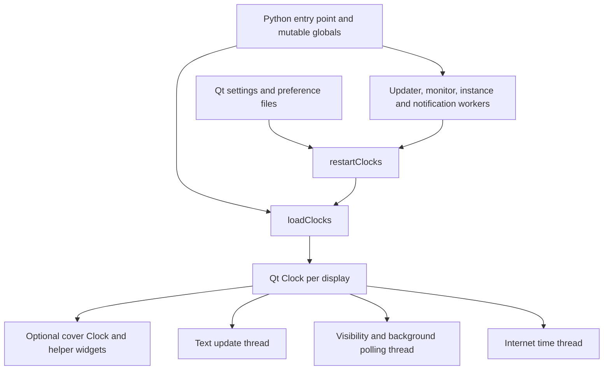
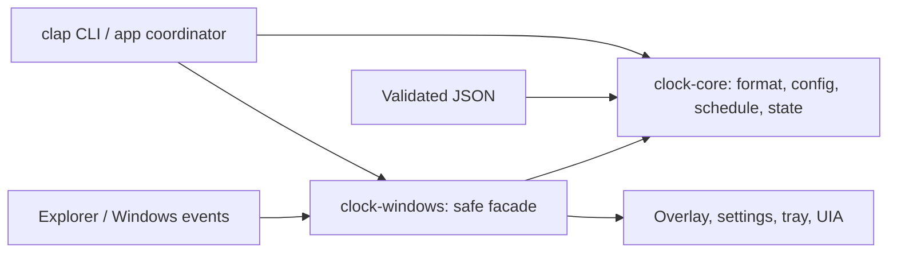

# Rust rewrite: source dissection and implementation contracts

Prepared 2026-10-13. This is an implementation proposal and assignment contract,
not a claim that Rust code or Windows compatibility has already been validated.
The [overview](RUST_REWRITE_PLAN.md) contains the retained feature scope and date
examples. The [issue index](RUST_REWRITE_ISSUES.md) records the execution backlog.

## 1. Evidence and conclusions

ElevenClock source baseline:
[`f967218`](https://github.com/tjorim/ElevenClock/tree/f967218e95b6f3c15e26f840e6090a6720528e39).
Stack reference:
[`tjorim/scat@8f94ead`](https://github.com/tjorim/scat/tree/8f94eadcf311ce9ff38727c029065dfee6dd0b03).
All source locations below refer to these immutable revisions.

ElevenClock's six top-level Python modules total 7,893 lines: `__init__.py`
2,037, `settings.py` 3,463, `welcome.py` 1,279, `tools.py` 980, `globals.py`
132, and `versions.py` 2. This excludes external helpers, resources and
translations. The settings and onboarding layers alone are 4,742 lines.
These counts describe scope, not a target line-count reduction or speed claim.

The current app already implements visual replacement through overlay/cover
windows. Rust changes ownership, rendering, configuration and event handling;
it does not make Explorer's private interfaces stable. The decisive risk remains
finding and tracking the exact native clock rectangle without covering the
notification bell or Show Desktop region.

### Current runtime flow



The responsibilities overlap: a Clock discovers Explorer, positions itself,
formats time, samples background pixels, handles gestures, tracks notifications,
and manages threads. Changes to a preference can rebuild the clocks. The rewrite
should preserve the visible behavior we need while separating those operations.

## 2. What to carry over from scat

These are observed project choices, not an inference that every dependency is
your personal preference. `scat` supplies no Windows GUI toolkit precedent.

| Evidence in scat | Decision for the clock | Adaptation |
| --- | --- | --- |
| `Cargo.toml`: edition 2024, rust-version 1.95.0; CI checks 1.95.0 | Start with Rust 2024 and MSRV 1.95.0; lock dependencies | Keep manifest, CI and contributor docs synchronized. scat's CONTRIBUTING still says 1.88.0; do not copy that stale value |
| `src/lib.rs`, `src/main.rs`: reusable library with thin executable | Separate pure core, Windows adapter and application | Three crates enforce the unsafe/platform boundary; app and Windows crates explicitly Windows-only |
| `src/error.rs`: thiserror; application uses anyhow contexts | Typed domain/platform errors, contextual app errors | Do not return opaque strings across the core API |
| `src/runtime.rs`: tracing and EnvFilter | Structured, bounded local diagnostics, RUST_LOG override | GUI logs go to a capped local file; one-shot CLI output stays clean |
| clap derive + serde_json | Small CLI and versioned JSON config | No YAML parser: a small clock config does not need two formats |
| chrono without default features, clock/std enabled | chrono 0.4 for civil time/ISO formatting | Pure core receives DateTime<FixedOffset>; Windows resolves the current local zone each update |
| `src/tui/search_worker.rs`: requests/results with IDs over std channels | Generation-tagged discovery results; no async runtime | Bound/coalesce requests; do not copy unbounded queues or unconditional joins around potentially blocked UIA calls |
| Cargo.lock, fmt, Clippy, MSRV, tests, cargo-deny/audit | Same checks, adapted to Windows and pure-core Linux jobs | Check audit-tool failures explicitly; do not copy a severity filter that may miss advisories with missing severity |
| proptest and criterion | Property tests for format/state invariants; focused format benchmark | Do not mistake a formatting microbenchmark for shell CPU or memory measurements |
| Release profile: thin LTO, one codegen unit, abort, strip | Use those release defaults; retain separate debug symbols for diagnostics | Windows x64 MSVC, not Linux musl; verify runtime DLL requirements on a clean Windows VM |
| README: offline, native binary, boring maintainable solutions | Offline runtime, native executable, small fixed settings surface | No webview, updater service, SQLite, Tree-sitter, Ratatui, Rayon or Tokio dependency without a new requirement |
| Unix-only compile gate and POSIX atomic swap | Declare platform support explicitly | Do not copy POSIX rename assumptions into Windows config replacement |

New platform-specific choices: the Microsoft `windows` crate, DirectWrite and
Direct2D for rendering, and native Win32 controls for the small settings dialog.
Using Tauri would add a web runtime and frontend stack without solving Explorer
integration. egui/Slint would still need the same shell adapter; revisit only if
native controls become a demonstrated maintenance problem. No GUI toolkit is
needed for the first compatibility spike.

## 3. Before → after implementation map

Paths on the right are beneath `rust/crates/`. R-items refer to the issue index.

| Current source / mechanism | Concrete replacement | Observable change / owner |
| --- | --- | --- |
| `__init__.py:1–87,1894–1989`, `globals.py`: imports, shared objects, boot | `clock-app/src/app.rs`, `clock-windows/src/runtime.rs`; explicit AppState and RAII resources | One instance and one UI event loop; no mutable Python-style globals. R01/R08 |
| `__init__.py:179 loadClocks`, `:276 restartClocks` | Reconcile overlays by transient taskbar ID and shell generation | Update/recreate only affected windows; avoid restarting all clocks for a format change. R06/R08 |
| `__init__.py:572`, `:700–774`: taskbar class lookup, preferred dimensions, covers | `clock-windows/src/taskbar/{probe,uia,geometry}.rs`; measured clock-only bounds | No guessed fixed-width slot. Unknown geometry leaves native clock visible. R02/R03 |
| `__init__.py:624–640,1194–1297`: topmost flags, registry-byte auto-hide, mouse polling | `clock-windows/src/events.rs` + core visibility reducer | Events plus bounded recovery polling; hide in step with actual taskbar/fullscreen state. R06/R08 |
| `__init__.py:988 loadTimeFormat`, `tools.py:153–190` expression DSL | `clock-core/src/format.rs`, explicit token allowlist | ISO preset and errors with positions; no arithmetic or offset expressions. R04 |
| `__init__.py:1314 updateTextLoop` formats every 0.1/0.25 seconds | `clock-core/src/schedule.rs`, Windows timer and one local snapshot per update | Second or minute cadence; repaint only when text/geometry/theme changes. R06/R08 |
| `__init__.py:1120 checkAndUpdateBackground`: grab a screen pixel and infer contrast | `clock-windows/src/{render,theme}.rs`, system theme/high-contrast colors | Opaque readable coverage; no screenshot sampling or promised translucent match. R07 |
| `__init__.py:799–841,1340–1407,1850`: keyboard shortcuts and gesture actions | `clock-windows/src/{interaction,tray}.rs`; native clock invocation with validated fallback | Click opens calendar/notifications; right-click fixed app menu. No arbitrary commands. R03/R09 |
| `tools.py:205–278`: per-setting files in ~/.elevenclock; restart side effects | `clock-core/src/config.rs` + `clock-windows/src/config_store.rs` | One validated JSON file; replace on disk before applying immutable config. R05 |
| `settings.py:43 SettingsUI`, `:3361 CustomSettings`; `welcome.py` | `clock-windows/src/settings.rs`, core preview and validation | One compact settings dialog, no wizard or per-monitor override UI. R10 |
| `__init__.py:285`: timestamp lockfiles scanned every two seconds | `clock-windows/src/instance.rs` session/user-scoped named mutex and fixed settings signal | Duplicate launch opens existing settings; no heartbeat files. R08 |
| `__init__.py:245,340,1943`: monitor/sleep polling and process restart | Display, DPI, power, session, time and TaskbarCreated messages | Resume/re-discover in process; dispose stale HWNDs. R08 |
| `__init__.py:1474 loadInternetTimeOffset`, `external/timezones.py` | OS local time only | No internet requests, custom offset or timezone catalog. R04/R08 |
| `__init__.py:238`, `external/WnfReader.py`, label notification helpers | Omit; preserve Explorer's adjacent notification controls | No undocumented WNF subscription or duplicated bell. R03/R09 |
| `__init__.py:88–168` updater, settings announcements, language downloads | Omit from runtime; manual releases | No updater/announcement/download threads. R14/R15 |
| `tools.py:113`, startup stdout capture, crash browser URL | `clock-app/src/{diagnostics,logging}.rs` with tracing | Local capped logs and explicit diagnostic export; no automatic browser crash upload. R11 |
| `ElevenClock.iss:130` autostart; existing AppId and reset/uninstall tasks | New app identity, own startup entry and dedicated per-user install directory | Opt-in startup; uninstall does not kill/remove legacy ElevenClock. R12/R14 |
| `build.cmd`, `elevenclock.spec`, Python compileall CI | Cargo locked MSVC build, core tests, native artifact smoke tests | No Python/Qt needed in final release; legacy removal only after gates. R01/R14/R15 |

## 4. Target boundaries and interfaces



Dependency direction: app → windows → core, and app → core. Core must never
import Win32 types. `#![forbid(unsafe_code)]` in core and app. Native controls,
message-loop callbacks, console attachment, startup and filesystem FFI all live
in the Windows crate behind safe wrappers. Use RAII and document thread affinity
and callback lifetime. HWNDs and COM interfaces never cross worker channels.

```text
rust/Cargo.toml, Cargo.lock
rust/crates/clock-core/src/{lib,error,model,format,config,schedule,state}.rs
rust/crates/clock-windows/src/{lib,runtime,events,instance,config_store}.rs
rust/crates/clock-windows/src/taskbar/{mod,probe,uia,geometry}.rs
rust/crates/clock-windows/src/{overlay,render,theme,interaction,tray,settings,startup}.rs
rust/crates/clock-app/src/{main,cli,app,diagnostics,logging}.rs
docs/windows-evidence/                 # exact build IDs and manual outcomes
```

R01 defines and documents the minimal contracts; subsequent issues add behavior
without broad API redesign. Proposed shapes, not pre-validated Rust source:

```rust
CompiledFormat::parse(&str) -> Result<CompiledFormat, FormatError>
CompiledFormat::render(DateTime<FixedOffset>) -> Result<ClockText, FormatError>
CompiledFormat::cadence() -> Cadence // Second or Minute, date-only is Minute
Config::validate(self) -> Result<ValidatedConfig, ConfigError>
ConfigStore::load() -> Result<ValidatedConfig, StoreError>
ConfigStore::save(&ValidatedConfig) -> Result<(), StoreError>
next_delay(snapshot, cadence) -> Duration
reduce(state, event) -> (state, Vec<Effect>)
WindowsRuntime::run(validated_config) -> Result<(), PlatformError>
```

Shared models: `PhysicalRect` uses signed coordinates and validated positive
size; `TaskbarId` is transient and paired with a `ShellGeneration`; a
`TaskbarSnapshot` contains taskbar rect, optional proven clock rect, monitor
identity, DPI, primary flag, visibility and discovery strategy. Selected
monitors are simply `primary` or `all`, so v1 needs no persistent display IDs.

Core state per taskbar: `Unavailable`, `Hidden(reason)` or `Visible`. Inputs
include `TopologyChanged`, `DiscoveryResult(generation, snapshots)`,
`VisibilityChanged`, `Tick`, `TimeChanged`, `ThemeChanged`, `ConfigApplied`,
`ExplorerLost`, `SessionLocked`, `SessionUnlocked` and `Quit`. Effects include
`Discover`, `Create/DestroyOverlay`, `SetBounds`, `Paint`, `Hide` and `ArmTimer`.
Discard responses from older shell generations. Failures are explicit, never
silently converted to a plausible rectangle.

### Time and format contract

Keep the overview's token allowlist. Limit input to 256 Unicode scalar values,
at most two nonempty lines, and rendered output to 512 Unicode scalar values. Normalize
CRLF once; permit newline but reject other control characters. No `%n`, padding
modifiers, unlisted directives, HTML or arithmetic. Parse into owned tokens once.
Report an offending token with a documented character-index span.

Use `%H:%M\n%g%V.%u` as the proposed initial preset; the settings UI must call it
"ISO week date". Offer a "Calendar year + ISO week" preset with `%y%V.%u`.
The user example is compatible with both; do not hide their New Year difference.
Take one OS-local snapshot for all clocks and preview lines. Snapshot fixed
offset is a value at an instant, not a persistent timezone rule. Re-resolve
local time on each wake/resume/timezone change; never add 24 hours to find the
next local date. Align normal waits to the next second/minute, using a monotonic
wait and a fresh wall-clock read on wake. Date-only formats recheck each minute.

### Configuration contract

```json
{
  "schema_version": 1,
  "format": "%H:%M\n%g%V.%u",
  "monitors": "primary",
  "font_size_pt": 9.0,
  "theme": "system"
}
```

Path: `%LOCALAPPDATA%\ElevenClockRust\config.json`; path override through
`--config`, then `ELEVEN_CLOCK_CONFIG`, then the default path. Reject unknown
fields/versions, empty format, invalid enums, and font sizes outside 6–24 pt.
Resolve the default path through Windows Known Folders. Startup registration is
OS-owned state shown in settings, not a duplicated JSON boolean.

Loading a missing file uses defaults. Loading a malformed file preserves it,
shows the error and uses defaults for that launch. Saving validates first,
writes and flushes a temporary file in the same directory, closes it and uses
a tested Windows replacement operation (existing target and first-create paths).
Failed save leaves disk and active config unchanged. Validate layout on each
active monitor before Apply; future text/DPI overflow hides that monitor's
overlay and reports a diagnostic instead of widening over tray controls.
No file watcher or legacy import in v1; provide explicit Reload settings.

### Shell integration contract and experiments

Enumerate `Shell_TrayWnd` and `Shell_SecondaryTrayWnd`. Prototype UIA and native
child geometry; neither is assumed to expose a clock-only rectangle on every
Windows build. UIA provider latency and locale-independent selectors must be
measured. A rectangle is usable only if it belongs to the current Explorer
generation, fits the taskbar/monitor, and excludes neighboring controls.

The UI thread owns overlay HWNDs and graphics resources. One dedicated COM
worker owns UIA objects and sends value snapshots tagged with generation IDs.
Use a bounded/coalesced request queue and a result deadline. A deadline only
stops waiting: it cannot be assumed to cancel a blocking COM call. Keep at most
one stalled worker, do not respawn threads without bounds, and remove overlays
on failure. If evidence shows COM cannot provide bounded teardown, R02 must
select a cancellable alternative or an isolated same-executable helper process
and amend the ADR before implementation proceeds. Never invent cancellation.

Overlay is `WS_EX_TOOLWINDOW | WS_EX_NOACTIVATE` with borderless style, DPI v2
manifest, and an opaque background drawn only inside the measured clock slot.
Prototype relative z-order with `SetWindowPos` and test activation/taskbar
transitions. Do not keep an unconditional always-topmost window over apps, parent
into Explorer, change Explorer styles, or permanently disable the original clock.

Use `WM_DISPLAYCHANGE`, `WM_DPICHANGED`, `WM_SETTINGCHANGE`, `WM_THEMECHANGED`,
`WM_TIMECHANGE`, power/session messages and registered `TaskbarCreated` where
applicable; supplement with filtered out-of-context WinEvent hooks and a slow
recovery check (proposed two seconds). Auto-hide tracking may need a short,
bounded poll during a transition. Measure this rather than promising pure event
coverage. Hooks and callbacks must not do blocking UIA or expensive rendering.

Click strategy: first prove UIA invocation of the underlying clock without
invoking the overlay itself. If unsupported, test one deliberate Win+N action
per click with no stuck modifiers or repeated input. Unknown/failed invocation
removes the overlay for native access and reports the limitation. No synthetic
mouse click relay. Keyboard activation of the tray opens the same menu; settings
has normal tab order. A minimal UIA provider for the overlay exposes the displayed
clock and an invoke action, without announcing every second.

### CLI and diagnostics contract

One Windows executable, `elevenclock-rs.exe`, starts the GUI when called without
a subcommand. Use clap subcommands:

```text
elevenclock-rs format --format "%g%V.%u" --at "2026-10-13T12:00:00+02:00"
elevenclock-rs config validate --config PATH
elevenclock-rs doctor --json
elevenclock-rs settings
```

Format/validate must not start the shell/UI or acquire the GUI mutex. `doctor`
performs its own bounded read-only discovery; it does not query another process
over a new RPC protocol. JSON has `schema_version: 1`, OS build, architecture,
discovery strategy, per-monitor bounds/DPI and explicit unsupported reasons.
No usernames, paths or window titles unless deliberately requested. Exit codes:
0 success, 1 runtime/I/O failure, 2 invalid arguments/config, 3 unsupported shell.
For a GUI-subsystem binary, attach to an existing console only for CLI commands;
preserve inherited redirected stdout/stderr. Test piping from PowerShell, not
only `--help` in an interactive session. Normal GUI launch must not flash a console.

Logs use tracing, rotate at 1 MiB with at most three retained files, and record
state transitions rather than every repaint. No network logging. Portable builds
still use LocalAppData for preferences; "portable" means no installer required,
not silently writing beside an executable in a protected folder.

## 5. Phases and assignment rules

| Phase | Items | Exit gate |
| --- | --- | --- |
| P0 Foundation | R01 | Workspace, contracts, CI and contributor commands agree |
| P1 Feasibility | R02 discovery, R03 overlay prototype | Clock-only coverage and native access demonstrated on exact Windows builds |
| P2 Pure logic | R04 formatter, R05 config, R06 scheduler/state | Deterministic contracts/tests; can progress alongside P1 after R01 |
| P3 Working shell | R07 renderer, R08 lifecycle, R09 interaction/accessibility | Multi-monitor clock survives shell/display changes and remains usable |
| P4 Usability | R10 settings, R11 diagnostics, R12 startup | User can configure, diagnose, start and stop without editing source |
| P5 Release | R13 acceptance, R14 packaging/licensing, R15 cutover | Measured Windows evidence, install/rollback checks, Rust is default |

The exact dependency graph and issue URLs live in the issue index. Dispatch
R04 and R06 independently after R01; R05 follows R04 so it can validate formats.
Keep shared contract changes serialized.
P3 is blocked on a passed P1 gate. Discovery and shell/COM work need a
Windows-capable agent and experienced review. Pure logic tasks are appropriate
for lower-level agents. This is a plan for later assignment, not a claim that
agents have run or that Windows evidence exists.

Each issue must contain baseline source locations, owned files, exact behavior,
non-goals, dependencies, test commands and handoff evidence. Agents branch from
the integration branch after prerequisites land, implement one issue per PR,
and do not rename shared types unilaterally. Initially use `rust-rewrite-plan`
for documentation; R01 creates `rust-rewrite` from main with these planning docs
included. Feature branches target `rust-rewrite`; no automatic merge to main.

If a required Windows desktop is unavailable, an agent may complete code and
unit tests but must leave the manual gate unchecked. Do not mark the issue done
based on cross-compilation, mocked shell data or screenshots from another build.

## 6. Validation and release criteria

CI: Linux core tests/doc tests; Windows MSRV check of workspace/all targets;
Windows stable fmt, Clippy with warnings denied, tests/doc tests and locked
x86_64-pc-windows-msvc release build. Add dependency audit/license checks and
artifact smoke tests. No interactive Explorer result is inferred from CI.

Fixtures include ISO week 53 and year boundaries, Monday/Sunday, leap day,
Europe/Amsterdam spring/fall DST snapshots with explicit offsets, manual clock
jumps, stale discovery generations, negative monitor coordinates, DPI changes,
unknown schema and failed saves. Format fuzz/property tests must bound output
and never panic on Unicode or malformed tokens.

Manual evidence records exact Windows build/patch, hardware, monitors, DPI,
theme, commands, app commit and outcome. Exercise two supported stock Windows
11 x64 builds; one/two displays; 100/125/150/200% mixed DPI; auto-hide; fullscreen
per monitor; all adjacent clicks; calendar; screen reader; lock/resume;
hotplug/primary swap; Explorer restart; forced app kill; and clean uninstall.
The tested builds become the support list; this document does not choose build
numbers without running the experiment.

Performance targets remain provisional: under 0.2% total-machine idle CPU and
under 40 MiB private working set on a recorded two-monitor reference machine.
Use process CPU-time delta / (wall time × logical processors), not an ambiguous
Task Manager screenshot. Measure ten minutes in date/minute/seconds modes and
report memory, timer wakes and discovery rate; measure helper processes too if
R02 selects isolation. Eight-hour soak: sample handles/threads/memory for growth.
Document failures; do not weaken thresholds silently to obtain a pass.

Distribution retains applicable GPL/asset notices until the README/LICENSE
conflict is resolved from evidence. A Rust rewrite does not reset copyright.
Use a new installer AppId/startup identity. Archive the old baseline in Git,
retain legacy settings, and provide rollback instructions. Remove Python,
PyInstaller, Qt and obsolete workflows only in R15 after acceptance and packaging.
