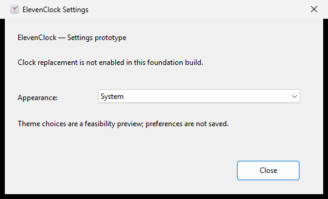

# R01 native Settings foundation evidence

Status: **interactive Windows acceptance pending**. This implementation was
prepared in a Linux cloud workspace without a Windows desktop. Cross-target
checks are compile evidence only. The first native CI run passed all five jobs:
[Actions run 38427469190](https://github.com/tjorim/ElevenClock/actions/runs/38427469190)
on feature commit 4391341. [Draft PR #19](https://github.com/tjorim/ElevenClock/pull/19)
targets the published `rust-rewrite` integration branch. CI is automated Windows
runner evidence, not a stock Windows 11 desktop acceptance run.

## Captured native evidence (automated)

All five jobs passed in [run 38452041598](https://github.com/tjorim/ElevenClock/actions/runs/38452041598)
including native launch, tab-cycle, forward/reverse focus navigation, PrintWindow
capture and close checks on feature commit b9b54e0. The captured run used Windows
Server 2025 Datacenter 10.0.26100 at 96 DPI (100%). The PR merge revision tested
was 299138c23a01bed13b8f6aef241d65f7b4b98e1a. Full context is retained in
[R01-context.json](R01-context.json); [the prototype artifact](https://github.com/tjorim/ElevenClock/actions/runs/38452041598/artifacts/11840408863)
contains the executable and original capture/context.



The captured window has readable text, standard controls and an application icon
at this DPI. The black outer border is the PrintWindow capture of non-client
margins. This single capture makes no claim about other DPI values, high contrast,
dark styling, screen-reader behavior or physical keyboard input. The focus checks
use native dialog navigation messages. These are not a substitute for the open
Windows 11 desktop checklist below. This workspace has no attached Windows
desktop; the repository runner inventory endpoint returned HTTP 403, so a suitable
self-hosted desktop runner could not be established through this connection.

## Prototype limitations / decision before R10

Standard Win32 controls with common-controls v6 use system accessibility colors.
Selecting Light or System does not override system/high-contrast settings.
Selecting Dark displays the unsupported dark-control limitation in the dialog;
it does not claim to apply dark styling. Universal documented dark styling for
classic controls is not established. Before R10, explicitly approve an accessible
system-color treatment or evaluate a bounded native UI alternative. Do not use
undocumented theme ordinals or call the theme matrix passed.

The manifest requests PerMonitorV2, asInvoker and common-controls v6. A standard
fixed-layout dialog delegates scaling to the DPI-v2 dialog manager. The label
mnemonic focuses the appearance combo, followed by Close; Escape/Enter and the
window X close the prototype. The existing repository icon is embedded. All these
behaviors still require observation on Windows, including mixed DPI and screen
reader labeling. There is no preference write, overlay or tray lifecycle yet.

## Record each run

Record commit, executable hash, toolchain, exact Windows build/patch, hardware,
monitor arrangement, DPI, theme/high contrast, screen reader version, commands,
observed result and screenshots. Use two stock Windows 11 x64 builds, standard
non-administrator account. Fill results rather than inferring them from CI.

- [x] Locked Windows MSRV/stable check, Clippy, tests/doc tests and x64 MSVC build
- [x] PE GUI subsystem + embedded DPI-v2 manifest/dialog/icon smoke checks
- [ ] Double-click opens Settings without a console and with correct app icon
- [ ] Tab/Shift+Tab, Alt+A, Alt+C, arrows, Enter, Escape and X behave correctly
- [ ] Screen reader announces title, appearance label/selection and Close
- [ ] System/light/dark feasibility and contrast limitation reviewed before R10
- [ ] High contrast retains readable controls, selection and visible focus
- [ ] 100/125/150/200%: no clipping, readable labels and correctly sized controls
- [ ] Move between mixed-DPI displays: layout, icon and focus remain usable
- [ ] Closing exits only this prototype; no Explorer/native clock changes

## Local command results

Source base: main 959d473902c4ce7b916815e165eccdb324f83496, local
`rust-rewrite` working tree. Linux x86_64; rustc 1.90.0
(1159e78c4 2025-09-14) and stable 1.99.0 (b940084d7 2026-09-28).

The following commands passed with each of `+1.90.0` and `+stable`:

```sh
cargo +TOOLCHAIN fmt --manifest-path rust/Cargo.toml --all --check
cargo +TOOLCHAIN test --manifest-path rust/Cargo.toml --workspace --locked
cargo +TOOLCHAIN test --manifest-path rust/Cargo.toml --workspace --doc --locked
cargo +TOOLCHAIN clippy --manifest-path rust/Cargo.toml --workspace --all-targets --locked -- -D warnings
cargo +TOOLCHAIN check --manifest-path rust/Cargo.toml --workspace --all-targets --locked --target x86_64-pc-windows-msvc
cargo +TOOLCHAIN clippy --manifest-path rust/Cargo.toml --workspace --all-targets --locked --target x86_64-pc-windows-msvc -- -D warnings
```

Each test run: one core geometry unit test and one rectangle doctest passed.
App/Windows host stubs contain zero Linux tests; this is not native coverage.
Explicit Linux `-p clock-core` tests and `-p clock-core --doc` also passed on
1.90.0. `cargo +1.90.0 tree --manifest-path rust/Cargo.toml -p clock-core --locked`
shows only chrono, num-traits and build-only autocfg, with no Windows dependencies.

`cargo +stable metadata --manifest-path rust/Cargo.toml --locked --format-version 1`
and `python3 scripts/rust-license-check.py <metadata.json>` passed, retaining
original dependency notices in `/workspace/scratch/dependency-notices.txt`.
Workflow/Dependabot YAML and the manifest XML parsed successfully.
`git diff --check` passed.

From the repository root the issue's original fmt command without `--all`
reported "Failed to find targets" on cargo-fmt 1.90 for this virtual workspace.
Using `--all` passes and is the command documented in CI/contributor instructions.

Advisory audit passed: cargo-audit 0.22.2, `cargo-audit audit --deny warnings`
from `rust/`; loaded 1,310 RustSec advisories and scanned 47 lockfile packages,
exit 0 with no findings/warnings. Used the upstream Linux release archive after
verifying its SHA-256 against GitHub release metadata; the slower source install
was stopped. CI installs the same version with `cargo install --locked`.

No interactive gate is passed by a cross-build. Native Windows MSRV/stable
checks, Clippy, tests/doc tests, SDK resource compilation and x64 MSVC release
builds passed in run 38427469190. Both executables passed the GUI subsystem,
embedded DPI-v2 manifest/dialog and native Settings launch/close checks. Loading
the embedded icon is mandatory at startup, so the successful Settings launch
also verifies the icon resource. Linux core jobs and advisory/license jobs passed.

The development-only `scripts/test-rust-settings.ps1` additionally checks the
native tab cycle and forward/reverse dialog focus messages and captures the
actual dialog with PrintWindow. Its context artifact identifies the runner OS,
build, DPI and commit. These checks are automated control evidence; they do not
simulate or substitute for the manual keyboard/DPI/theme/screen-reader matrix.
The harness and captures are not installed user tools. The manual checklist
above remains open.
